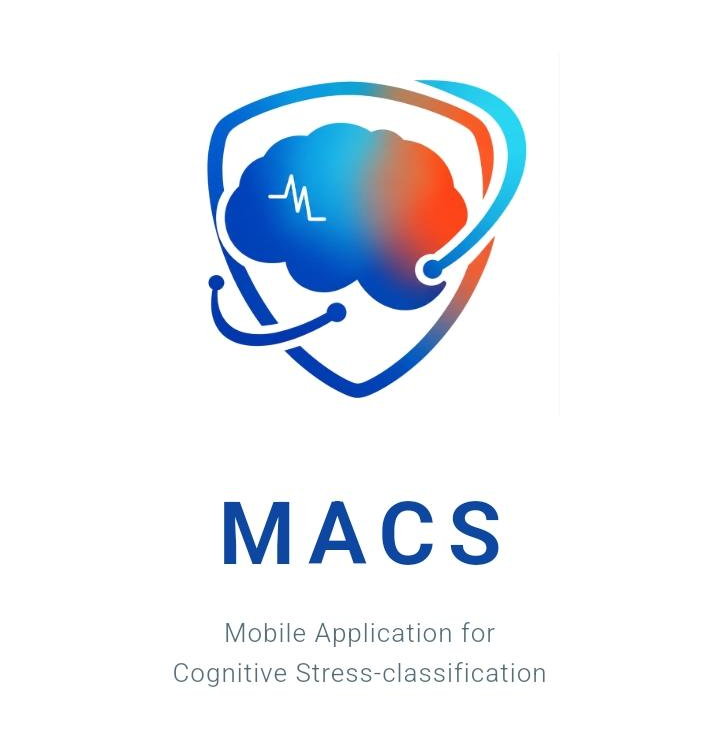
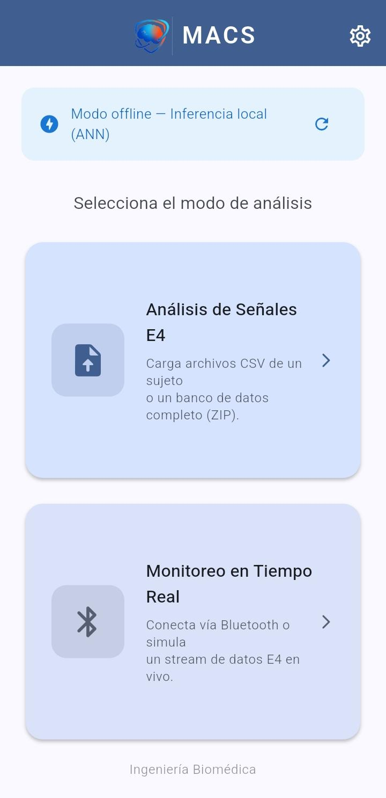
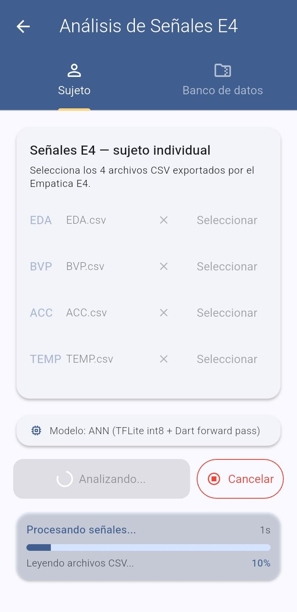
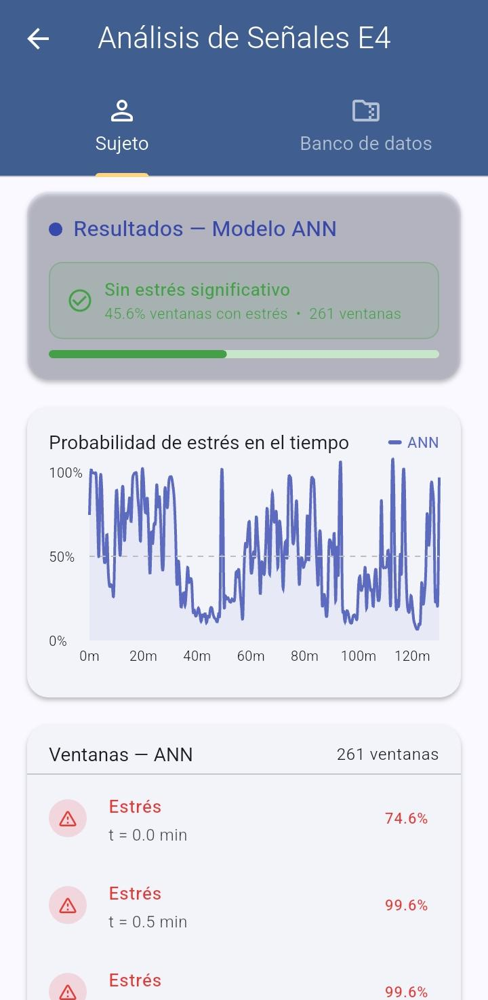
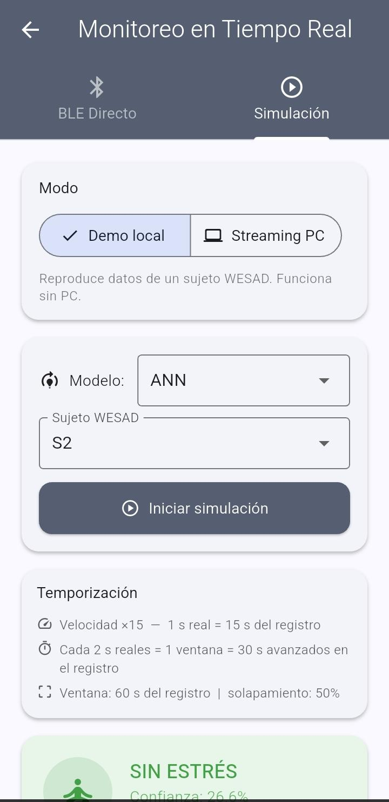
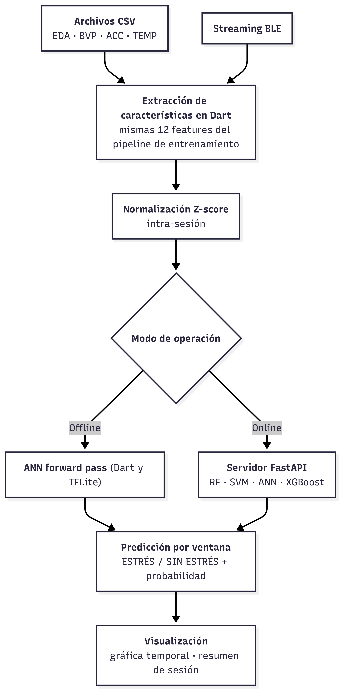
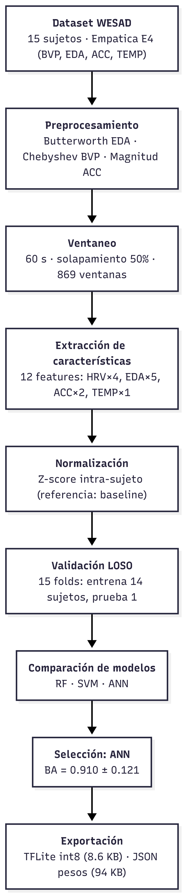

<p align="center">
  
</p>

<h1 align="center">MACS — Clasificación Móvil de Estrés</h1>

<p align="center">
  Clasificación binaria automática de estrés (baseline vs. estrés inducido por TSST) a partir de señales fisiológicas de muñeca (Empatica E4), desplegada como app móvil Flutter con capacidad offline.
</p>

<p align="center">
  <a href="README.md">Read in English</a>
</p>

---

## Descripción general

Este repositorio contiene el pipeline completo de una tesis de grado (Universidad Politécnica Salesiana, Ingeniería Biomédica) que desarrolla una aplicación móvil para la detección automática de estrés a partir de señales fisiológicas de un wearable, usando modelos de aprendizaje automático clásicos y livianos, aptos para despliegue en dispositivo.

**Pipeline:** preprocesamiento de señales crudas → extracción de características (EDA, HRV derivado de BVP, acelerómetro, temperatura cutánea) → ventaneo de 60 s → validación cruzada Leave-One-Subject-Out (LOSO) → selección de modelo → exportación a app Flutter (inferencia on-device con TFLite + backend FastAPI para streaming en tiempo real).

**Dataset principal:** [WESAD](https://www.eti.uni-siegen.de/ubicomp/home/datasets/icmi18/) (Schmidt et al., 2018, ACM ICMI) — 15 sujetos, sensores de pecho + muñeca (Empatica E4), protocolo de estrés TSST.

## Resultados (WESAD, LOSO, 15 folds)

| Modelo | Balanced Accuracy | F1 (macro) | ROC AUC |
|-------|:---:|:---:|:---:|
| **SVM** | **0.919 ± 0.108** | 0.914 ± 0.103 | **0.963 ± 0.074** |
| ANN (seleccionado para despliegue) | 0.910 ± 0.121 | 0.903 ± 0.120 | 0.934 ± 0.122 |
| RF | 0.899 ± 0.160 | 0.892 ± 0.172 | 0.946 ± 0.099 |
| XGBoost | 0.889 ± 0.176 | 0.879 ± 0.187 | 0.931 ± 0.140 |
| LDA (referencia de literatura, Schmidt et al. 2018) | 0.882 ± 0.171 | 0.879 ± 0.173 | 0.940 ± 0.106 |

SVM obtiene las mejores métricas offline, pero se **seleccionó ANN para el despliegue on-device** porque se convierte de forma directa a un modelo TFLite cuantizado (8-bit, ~9 KB) que ejecuta el forward pass completo en Dart sin depender de un backend. LDA se mantiene como alternativa aún más liviana (pesos en JSON, sin necesidad de librería de álgebra matricial). SVM, RF y XGBoost siguen disponibles vía el backend FastAPI para inferencia online.

Métricas completas, curvas ROC, matrices de confusión, estudio de ablación (impacto del acelerómetro / features de HRV) e importancia SHAP: [`results/`](results/).

### Validación cruzada entre datasets

El pipeline entrenado en WESAD se evaluó en modo zero-shot sobre un dataset independiente (Campanella et al. 2024, 29 sujetos, mismo dispositivo E4, protocolo distinto). La balanced accuracy cae a ~0.49–0.59 según el modelo (ANN el mejor, 0.589), confirmando la brecha de generalización esperada entre protocolos/poblaciones y motivando los datasets de validación listados como trabajo futuro. Ver [`results/campanella/`](results/campanella/).

## Aplicación móvil

App Flutter (`app/stress_app/`) + backend FastAPI (`app/backend/`) con tres modos de entrada: carga de CSV (análisis offline de una sesión completa), streaming simulado en tiempo real, y conexión BLE directa con el Empatica E4.

<p align="center">
  
  
  
  
</p>

<p align="center">
  
  
</p>

Ver [`app/README.md`](app/README.md) para las instrucciones completas de instalación (backend, Flutter SDK, build de Android) y uso.

## Estructura del repositorio

```
tesis_1/
├── app/                  App móvil Flutter + backend FastAPI
├── pipeline/             Preprocesamiento, extracción de features, LOSO, ablación, SHAP
├── scripts/              Puntos de entrada CLI (run_eda, run_pipeline, run_ablation,
│                         run_campanella, export_models, convert_tflite)
├── notebooks/            Análisis exploratorio (EDA_WESAD.ipynb)
├── models/               Modelos entrenados (.joblib) + exportaciones móviles (.tflite, pesos)
├── results/              Métricas LOSO, ablación, SHAP, validación cruzada entre datasets
├── eda_outputs/          Dataset ventaneado y normalizado, figuras del EDA
├── docs/images/          Diagramas, capturas de pantalla, logo
└── environment.yml       Entorno conda ("tesis", Python 3.14)
```

`data/WESAD/` **no** está incluido en este repositorio (~19 GB). Descargarlo desde la [fuente oficial](https://www.eti.uni-siegen.de/ubicomp/home/datasets/icmi18/) y extraerlo de forma que `data/WESAD/WESAD/S2/`, `S3/`, … coincidan con la estructura descrita en el `README.pdf` propio del dataset.

## Instalación

```bash
conda env create -f environment.yml
conda activate tesis
jupyter lab   # para notebooks/EDA_WESAD.ipynb
```

Paquetes clave: `numpy`, `pandas`, `scipy`, `neurokit2`, `scikit-learn`, `xgboost`, `matplotlib`, `seaborn`, `imbalanced-learn`.

## Uso del pipeline

```bash
# 1. EDA + dataset ventaneado de features
conda run -n tesis python scripts/run_eda.py

# 2. Validación cruzada LOSO (RF, SVM, ANN, XGBoost, LDA)
conda run -n tesis python scripts/run_pipeline.py

# 3. Estudio de ablación
conda run -n tesis python scripts/run_ablation.py

# 4. Validación cruzada entre datasets (Campanella)
conda run -n tesis python scripts/run_campanella.py

# 5. Exportar modelos para la app móvil (.joblib, pesos TFLite, metadata)
conda run -n tesis python scripts/export_models.py
```

## Vector de características (12 features)

| Grupo | Features |
|-------|----------|
| EDA (5) | `scl_mean`, `scl_std`, `scr_count`, `scr_amp_mean`, `phasic_energy` |
| Acelerómetro (2) | `acc_mag_std`, `acc_movement` |
| HRV, desde BVP (4) | `hrv_mean_rr`, `hrv_sdnn`, `hrv_rmssd`, `hrv_pnn50` |
| Temperatura cutánea (1) | `temp_mean` |

Seleccionadas entre 16 candidatas mediante pruebas estadísticas (p < 0.05, \|d de Cohen\| ≥ 0.5) sobre ventanas de 60 s, 50% de solapamiento, normalizadas con z-score intra-sujeto.

## Cita

Si usás este pipeline o hacés referencia a este trabajo, por favor citá el dataset WESAD:

```
Schmidt, P., Reiss, A., Duerichen, R., Marberger, C., & Van Laerhoven, K. (2018).
Introducing WESAD, a multimodal dataset for wearable stress and affect detection.
Proceedings of the 20th ACM International Conference on Multimodal Interaction, 400–408.
```

## Autor

Carlos Ariel Ortega — Ingeniería Biomédica, Universidad Politécnica Salesiana (2026).
Tesis: *Desarrollo de una Aplicación Móvil para la Clasificación Automática de Estados de Estrés Mediante Señales Fisiológicas y Aprendizaje Automático con Validación Experimental.*
