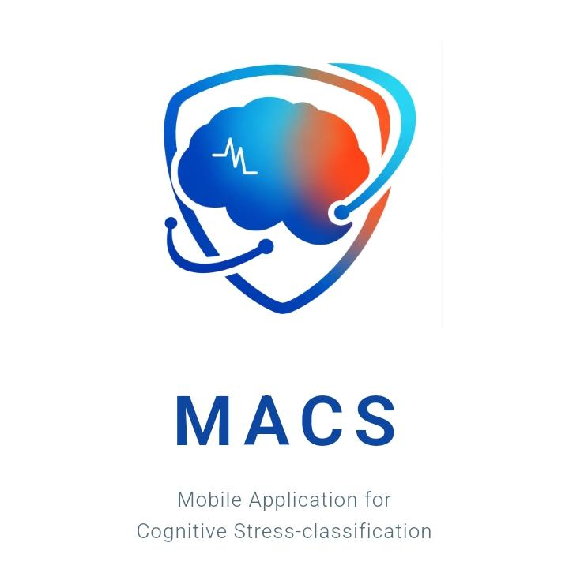
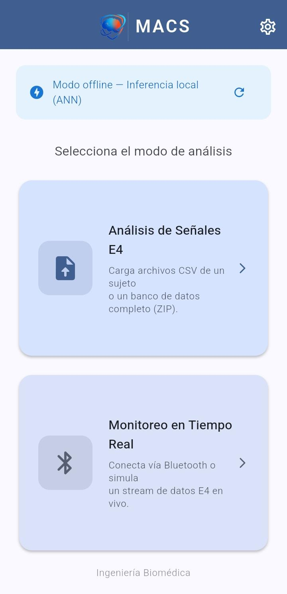
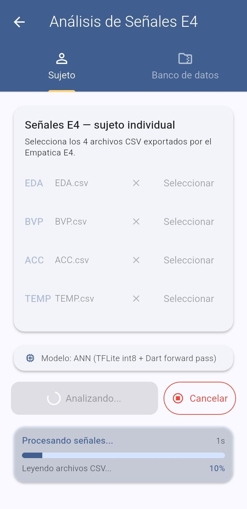
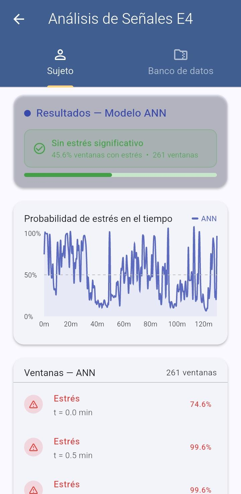
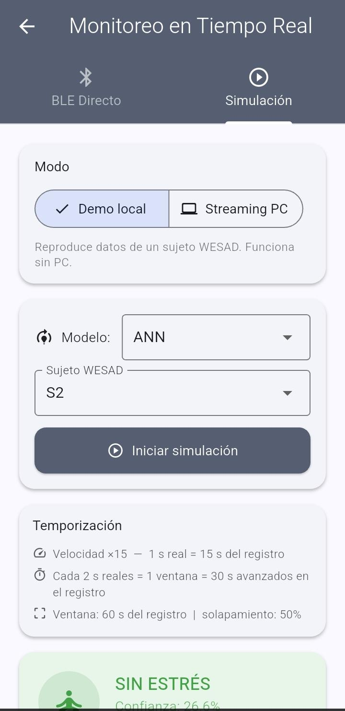
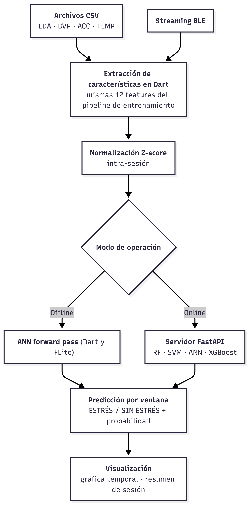
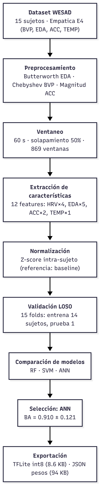

<p align="center">
  
</p>

<h1 align="center">MACS — Mobile Stress Classification</h1>

<p align="center">
  Automatic binary stress classification (baseline vs. TSST-induced stress) from wrist-worn physiological signals (Empatica E4), deployed as an offline-capable Flutter mobile app.
</p>

<p align="center">
  <a href="README.es.md">Leer en español</a>
</p>

---

## Overview

This repository contains the full pipeline of an engineering thesis (Universidad Politécnica Salesiana, Biomedical Engineering) developing a mobile application for automatic stress detection from wearable physiological signals, using classic and lightweight machine learning models suitable for on-device deployment.

**Pipeline:** raw signal preprocessing → feature extraction (EDA, BVP-derived HRV, accelerometer, skin temperature) → 60 s windowing → Leave-One-Subject-Out (LOSO) cross-validation → model selection → export to a Flutter app (on-device TFLite inference + FastAPI backend for streaming/real-time use).

**Primary dataset:** [WESAD](https://www.eti.uni-siegen.de/ubicomp/home/datasets/icmi18/) (Schmidt et al., 2018, ACM ICMI) — 15 subjects, chest + wrist (Empatica E4) sensors, TSST stress protocol.

## Results (WESAD, LOSO, 15 folds)

| Model | Balanced Accuracy | F1 (macro) | ROC AUC |
|-------|:---:|:---:|:---:|
| **SVM** | **0.919 ± 0.108** | 0.914 ± 0.103 | **0.963 ± 0.074** |
| ANN (selected for deployment) | 0.910 ± 0.121 | 0.903 ± 0.120 | 0.934 ± 0.122 |
| RF | 0.899 ± 0.160 | 0.892 ± 0.172 | 0.946 ± 0.099 |
| XGBoost | 0.889 ± 0.176 | 0.879 ± 0.187 | 0.931 ± 0.140 |
| LDA (literature baseline, Schmidt et al. 2018) | 0.882 ± 0.171 | 0.879 ± 0.173 | 0.940 ± 0.106 |

SVM achieves the best offline metrics, but **ANN was selected for on-device deployment** because it converts cleanly to a quantized TFLite model (8-bit, ~9 KB) that runs a full forward pass in Dart with no backend dependency. LDA is kept as an even lighter fallback (JSON weights, no matrix multiply library needed). SVM, RF and XGBoost remain available through the FastAPI backend for online inference.

Full metrics, ROC curves, confusion matrices, ablation study (impact of accelerometer / HRV features) and SHAP feature importance: [`results/`](results/).

### Cross-dataset validation

The WESAD-trained pipeline was evaluated zero-shot on an independent dataset (Campanella et al. 2024, 29 subjects, same E4 device, different protocol). Balanced accuracy drops to ~0.49–0.59 depending on the model (ANN best at 0.589), confirming the expected generalization gap across protocols/populations and motivating the validation datasets listed below as future work. See [`results/campanella/`](results/campanella/).

## Mobile App

Flutter app (`app/stress_app/`) + FastAPI backend (`app/backend/`) supporting three input modes: CSV upload (offline session analysis), simulated real-time streaming, and direct BLE from the Empatica E4.

<p align="center">
  
  
  
  
</p>

<p align="center">
  
  
</p>

See [`app/README.md`](app/README.md) for full setup instructions (backend, Flutter SDK, Android build) and usage.

## Repository structure

```
app-stress/
├── app/                  Flutter mobile app + FastAPI backend
├── pipeline/             Preprocessing, feature extraction, LOSO, ablation, SHAP
├── scripts/              CLI entry points (run_eda, run_pipeline, run_ablation,
│                         run_campanella, export_models, convert_tflite)
├── notebooks/            Exploratory data analysis (EDA_WESAD.ipynb)
├── models/               Trained models (.joblib) + mobile exports (.tflite, weights)
├── results/              LOSO metrics, ablation, SHAP, cross-dataset validation
├── eda_outputs/          Windowed + normalized feature dataset, EDA figures
├── docs/images/          Diagrams, screenshots, logo
└── environment.yml       Conda environment ("tesis", Python 3.14)
```

`data/WESAD/` is **not** included in this repository (~19 GB). Download it from the [official source](https://www.eti.uni-siegen.de/ubicomp/home/datasets/icmi18/) and extract it so that `data/WESAD/WESAD/S2/`, `S3/`, … match the layout described in the dataset's own `README.pdf`.

## Setup

```bash
conda env create -f environment.yml
conda activate tesis
jupyter lab   # for notebooks/EDA_WESAD.ipynb
```

Key packages: `numpy`, `pandas`, `scipy`, `neurokit2`, `scikit-learn`, `xgboost`, `matplotlib`, `seaborn`, `imbalanced-learn`.

## Pipeline usage

```bash
# 1. EDA + windowed feature dataset
conda run -n tesis python scripts/run_eda.py

# 2. LOSO cross-validation (RF, SVM, ANN, XGBoost, LDA)
conda run -n tesis python scripts/run_pipeline.py

# 3. Ablation study
conda run -n tesis python scripts/run_ablation.py

# 4. Cross-dataset validation (Campanella)
conda run -n tesis python scripts/run_campanella.py

# 5. Export models for the mobile app (.joblib, TFLite weights, metadata)
conda run -n tesis python scripts/export_models.py
```

## Feature set (12 features)

| Group | Features |
|-------|----------|
| EDA (5) | `scl_mean`, `scl_std`, `scr_count`, `scr_amp_mean`, `phasic_energy` |
| Accelerometer (2) | `acc_mag_std`, `acc_movement` |
| HRV, from BVP (4) | `hrv_mean_rr`, `hrv_sdnn`, `hrv_rmssd`, `hrv_pnn50` |
| Skin temperature (1) | `temp_mean` |

Selected from 16 candidates via statistical testing (p < 0.05, \|Cohen's d\| ≥ 0.5) on 60 s windows, 50% overlap, z-score normalized intra-subject.

## Citation

If you use this pipeline or refer to this work, please cite the WESAD dataset:

```
Schmidt, P., Reiss, A., Duerichen, R., Marberger, C., & Van Laerhoven, K. (2018).
Introducing WESAD, a multimodal dataset for wearable stress and affect detection.
Proceedings of the 20th ACM International Conference on Multimodal Interaction, 400–408.
```

## Author

Carlos Ariel Ortega — Biomedical Engineering, Universidad Politécnica Salesiana (2026).
Thesis: *Desarrollo de una Aplicación Móvil para la Clasificación Automática de Estados de Estrés Mediante Señales Fisiológicas y Aprendizaje Automático con Validación Experimental.*
